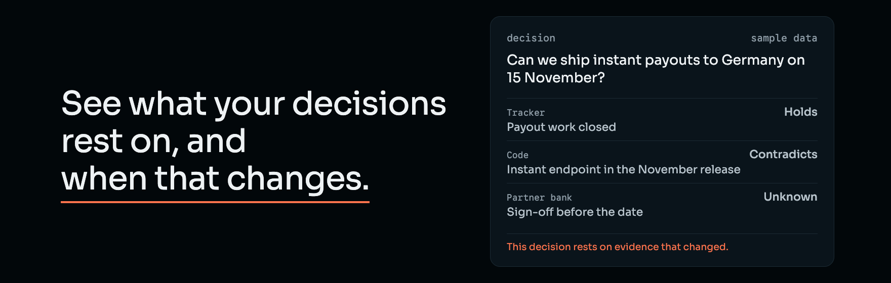

Every decision in a company rests on a few facts: a ticket closed, a contract signed, a vendor's data region, a partner's sign-off. Those facts live in different tools and change quietly.

Relvald records what a decision rests on and checks each piece against the evidence by fixed rules. Each piece gets one of three answers: Holds, Contradicts or Unknown. Unknown is not No.

A person makes the decision, and the reasons stay with it. When the evidence under a decision changes, Relvald marks that decision.

## Where we are

- **Today:** an early prototype, run by its founder. It works on two sample decisions, one at a time: *"Can we keep vendor X for our EU customers?"* and *"Can we ship instant payouts to Germany on 15 November?"* The evidence in both is entered by hand. No customers yet, and not yet used on a real team's decision.
- **Being built:** one question across all of a company's decisions: *"Which decisions rest on evidence that changed?"*
- **Planned:** AI that reads the sources a team gives it access to (tracker, code, documents, chat, email) and drafts each decision for a person to approve. A person always decides.
- **Planned:** an on-prem version that runs inside a team's own infrastructure, for teams that can't send data out.

The product code is not public yet.

## Send one decision

The first case is free. A date you've promised is the easiest place to start.

[relvald.com](https://relvald.com/#founder) 
[founder@relvald.com](mailto:founder@relvald.com)
